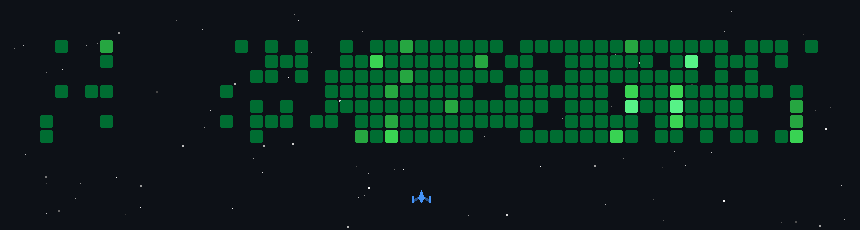

<!-- ===================== HEADER ===================== -->


<h2 align="center">
  
</h2>

<p align="center">
  <b>Full Stack Development · AI/ML · AI Agents · Backend Engineering</b>
</p>

<p align="center">
  <a href="mailto:rsarvatha@gmail.com">
    
  </a>
  <a href="https://linkedin.com/in/r-sarvatha">
    
  </a>
  <a href="https://github.com/Sarvatha02">
    
  </a>
</p>

---

<!-- ===================== SPACE INVADERS ===================== -->

<p align="center">
  
</p>

---

## About Me

Computer Science Engineering graduate focused on **Full-Stack Development, AI/ML, and AI-powered applications**. Experienced in building web applications, REST APIs, database-driven systems, and intelligent software solutions using Python, JavaScript, React.js, Spring Boot, Flask, FastAPI, PostgreSQL, and MySQL.

- Strong foundation in **Data Structures, Algorithms, OOP, and DBMS**.
- Hands-on experience in **full-stack web development and REST API development**.
- Experience building AI/ML applications using **XGBoost, NLP, and Scikit-learn**.
- Experience with **PostgreSQL, MySQL, and Supabase**.
- Familiar with **JWT authentication, Spring Security, and role-based access control**.
- Experience with **Git, GitHub, API integration, and frontend-backend integration**.
- Interested in **AI agents, LLM integration, intelligent automation, and scalable software systems**.

---

## Core Skills & Technologies

<table width="100%" align="center">
<tr>
<td width="33%" valign="top">

### Backend Development

<p align="center">
  
</p>

<p align="center">
  
  
  
  
</p>

</td>
<td width="33%" valign="top">

### Frontend Development

<p align="center">
  
</p>

<p align="center">
  
  
  
</p>

</td>
<td width="33%" valign="top">

### Tools & Technologies

<p align="center">
  
</p>

<p align="center">
  
  
  
</p>

</td>
</tr>

<tr>
<td width="33%" valign="top">

### Databases

<p align="center">
  
</p>

<p align="center">
  
  
  
</p>

</td>
<td width="33%" valign="top">

### AI & Machine Learning

<p align="center">
  
</p>

<p align="center">
  
  
  
  
  
  
</p>

</td>
<td width="33%" valign="top">

### AI & LLM Development

<p align="center">
  
  
  
  
  
</p>

</td>
</tr>
</table>

---

## Programming Languages

<p align="center">
  
</p>

---

## Projects

| Project | Description | Technology Stack |
|---|---|---|
| **Global IP Intelligence Platform** | Web application designed to simplify patent search and analysis across multiple sources. | React.js · Tailwind CSS · Java · Spring Boot · Spring Security · PostgreSQL |
| **Intelligent Dyslexia Detection System** | AI-powered screening platform that evaluates reading, spelling, memory, and phonological awareness to provide risk prediction and severity classification. | React.js · FastAPI · XGBoost · Supabase · PostgreSQL |
| **Domyniq Hyperautomation Prospect Discovery & Engagement Engine** | Prospect intelligence and outreach automation platform that discovers companies, enriches contacts, verifies professional emails, and supports AI-assisted personalized outreach. | Python · OpenAI API · Apollo.io · Prospeo · Brevo · AsyncIO |
| **Crypto Portfolio Tracker** | Cryptocurrency portfolio management application with asset tracking, portfolio analytics, scam detection, trade monitoring, and tax-ready reporting features. | React.js · Spring Boot · MySQL · CoinGecko API · JWT |
| **Smart Budget Tracker** | Full-stack expense management application with CRUD operations, spending categories, database storage, and financial insights. | HTML · CSS · JavaScript · MySQL |
| **Software Testing Project** | Manual and automated testing project involving test case design, bug tracking, and validation of application functionality. | Selenium · Java · Manual Testing |

---

## Experience

| Role | Organization | Period | Work Mode |
|---|---|---|---|
| **Java Full Stack Intern** | Infosys Springboard | Nov 2025 – Jan 2026 | Remote |
| **Full Stack Developer Intern** | M8 IT Solutions | Jul 2025 – Sep 2025 | Onsite |

---

## Education

| Degree | Institution | Period | Grade |
|---|---|---|---|
| **B.E. Computer Science and Engineering** | SSM Institute of Engineering and Technology | 2022 – 2026 | Approximately 8.2 CGPA |

---

## LeetCode Stats

<p align="center">
  
</p>

---

## GitHub Stats

<p align="center">
  
  
</p>

---

<p align="center">
  <i>Building practical software solutions at the intersection of full-stack development and artificial intelligence.</i>
</p>

<p align="center">
  
</p>
```
